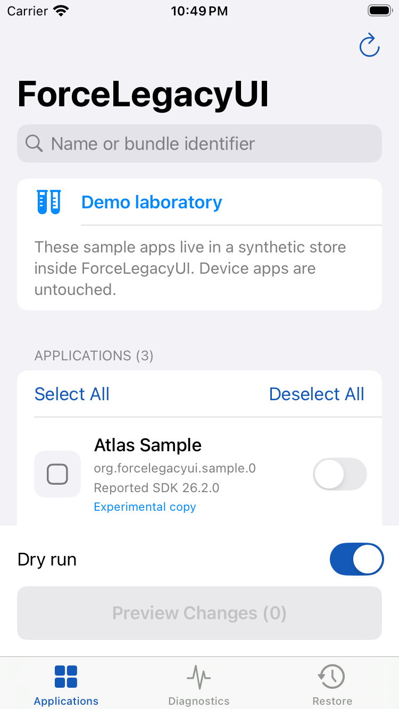

# Validation evidence

## 0.1.8 validation

Version **0.1.8, build 10**, application source
[`c4d89f25`](https://github.com/Justintunsday/ForceLegacyUI/commit/c4d89f2568a2f2ac4d7552f115535098fd460b46),
passed [run 44079799734](https://github.com/Justintunsday/ForceLegacyUI/actions/runs/44079799734)
on `macos-15-intel` with Xcode 26.2.

* **46 core XCTest cases, 60 native regression cases and 5 offline analysis tests passed.**
  New synthetic cases check the exact 572 candidate, one-witness read-only decoding
  without write authorization, ambiguous/wrong SDK refusal, excluded null-placeholder
  records, malformed non-null paths, and full-evidence one-SDK-field planning.
  Injected native cases preserve the UUID/fixed-root query scope through alternate
  flag retries, dispose denied/tokenless queries and retain paired token ownership.
* Normal and MHA device apps built. The iOS 26.2 x86_64 iPhone 17 Pro simulator
  launched the three normal apps, exported both probe reports, returned **148 native
  registrations** with `isDemo: false`, and passed synthetic preview/apply/backup/
  restore/ZIP export. The restored SHA matched the original
  `036b8a8fea6b258779071264cbde428629d4a588fd6800365fec8bbf7ea10e36`.
* All four downloaded IPAs passed independent ZIP, SHA sidecar, version/build,
  arm64 and requested-entitlement checks. Apple-provisioned signing was skipped;
  the IPAs require re-signing.

Main IPA SHA-256: `05b48d43c0f4094b687ae48653c75bda114fefc8ba3aa9e754578fd3ef490aca`.
MHA IPA SHA-256: `606d05f9ae52d361a87c1816a6e4f42d5b95b8255dea9f3152eb7d5f7ab9901e`.
Artifact ID `14327241741`; GitHub-reported ZIP digest
`6dd085f754c576781b57df23615ee4b8c6328f8d924ec5322b69f633433faaec`.
Evidence: [0.1.8 records](evidence/v0.1.8/).

The private, matching user ZIP was reviewed locally, not sent to CI or committed.
Its original hash remained unchanged. [Field review](LAYOUT-572.md) found the
572-byte candidate and linked serialized compatibility Booleans. Only one native
SDK witness was available, so this does not authorize live writes. The candidate
is restricted to **26.6.2 / 23G90 / arm64**; no arm64e capture was reviewed.

**No phone success for the alternate flag retry, live SDK write, cached-Boolean
rewrite or legacy appearance is claimed.** The read-only evidence type cannot
be used as the write proof. The three-app/two-SDK requirement and empty compiled
reviewed-live allowlist remain in force.


## 0.1.7 validation

Version **0.1.7, build 9**, source
[`ee56658b`](https://github.com/Justintunsday/ForceLegacyUI/commit/ee56658b6c8fbbdb6717a666c6d63ed765b9283c),
passed [run 44072817445](https://github.com/Justintunsday/ForceLegacyUI/actions/runs/44072817445)
on `macos-15-intel` with Xcode 26.2.

* **41 core XCTest cases, 58 native regression cases and 5 offline analysis tests passed.**
  Added cases verify fallback after denied or unavailable worse_query methods,
  exact UUID/root query domains, the fixed class/group/part/flags contract,
  preflight directory checks, refused unsafe paths, missing paired APIs, denied
  queries, absent tokens, read-target binding and per-attempt token release.
  Transport and access responses are injected; this does not exercise a real
  phone sandbox extension.
* Normal and separate MHA device apps built. The iOS 26.2 x86_64 iPhone 17 Pro
  simulator launched all three normal apps, exported both probe reports and
  returned 148 native registrations with `isDemo: false`. The synthetic app-engine
  preview/apply/backup/restore/ZIP cycle passed and restored SHA-256
  `036b8a8fea6b258779071264cbde428629d4a588fd6800365fec8bbf7ea10e36`.
* All four downloaded IPAs passed independent ZIP, SHA sidecar, version/build,
  arm64 and requested-entitlement checks. No Apple provisioning credentials were
  supplied, and optional signing was skipped. Every IPA requires re-signing.

Main IPA SHA-256: `94972ea398173767e19098c2fca5185e66d284e140002b57b9c77673e9bae615`.
MHA IPA SHA-256: `44ae96d3d33b05fefe4674e4e661c055af2fa0903ad162ab3fde492b46ac1357`.
Artifact ID `14323319420`; GitHub-reported ZIP digest
`7b055c15e56d8767e00cedc35512d43b70143fbfa89a4a2822e4ad63db989ed5`.
Evidence: [0.1.7 records](evidence/v0.1.7/).

The bundle reader now tries traversal for its UUID and then the one fixed
Bundle/Application root used by the reference metadata reader. The latter
capability is broader than the read target, which remains the original validated
UUID/name, Info.plist and bounded executable headers. It performs no root-wide
enumeration or signed-bundle write, checks a pre-existing nonsymlink directory
before querying, and releases each token after that metadata attempt. Cache/write
path policy is not broadened. See [SAFETY.md](SAFETY.md).

**No improved phone access, live SDK write or legacy appearance is claimed.**
The reported 572-byte layout still has no included profile; one self-SDK witness
from the user's 0.1.6 log is insufficient to authorize it. A matching report/raw
snapshot and independent SDK observations remain required for field review.

## 0.1.6 validation

Version **0.1.6, build 8**, source
[`14919cb4`](https://github.com/Justintunsday/ForceLegacyUI/commit/14919cb4a044e25d1922569364397d4d8cb15a96),
passed [run 44064110113](https://github.com/Justintunsday/ForceLegacyUI/actions/runs/44064110113)
on `macos-15-intel` with Xcode 26.2.

* **41 core XCTest cases, 51 native regression cases and 5 offline analysis tests passed.**
  New coverage checks unique folded-name matching, ambiguous/oversized listings,
  actual bundle identity and SDK reads, retry after a subfile failure despite a
  readable directory, positive-token release and alternate flags, missing release
  callbacks, symlink/identity refusal, same-UUID spelling correlation and receipt
  compatibility. File fixtures and injected grant results do not test a real
  sandbox extension or establish phone access.
* Normal device apps, the separate MHA device app and simulator apps built.
  A fresh iPhone 17 Pro simulator on **iOS 26.2, x86_64** launched the normal app
  and both probes. Both probes exported their facts. Native enumeration returned
  **148 registrations** with `isDemo: false`. The app completed synthetic preview,
  apply, durable backup, restore and ZIP export; the restored SHA matched the
  original `036b8a8fea6b258779071264cbde428629d4a588fd6800365fec8bbf7ea10e36`.
* All four downloaded IPAs passed independent ZIP, SHA sidecar, version/build,
  arm64 Mach-O and requested-entitlement checks. The standard app requests its
  dedicated App Group; MHA retains its exact ID/mode and no group request.
  No provisioning credentials were supplied, so optional Apple signing was skipped.
  All IPAs require re-signing before installation.

Main IPA SHA-256: `37ada96f96510a57d8dfde99ecf84351e3cfc41fbf0d5083e91f12363c65b6c0`.
MHA IPA SHA-256: `f639e534c96987e4dc7102d3078c29b34e90d81c592ad13d30212b8a5c393421`.
Artifact ID `14321315153`; GitHub-reported ZIP digest
`c5d29160dbb4be85a4e347212a4f70ecf6b5a55d953424a9763c78df12093282`.
Evidence: [0.1.6 records](evidence/v0.1.6/).

The update addresses missing same-container spelling resolution and metadata-read
grant retries exposed during review of the user's 0.1.5 ENOENT log below. The
attempted app-bundle path strings and raw snapshot were not supplied, so those omissions are not claimed
as the conclusively verified cause on that phone. The current app is prioritized
as an independent SDK witness; individual LS URLs are spelling hints only and
must stay within the same UUID/name. Resolved metadata must still match the real
Info.plist identity, executable SDK and fingerprints. Live store paths retain
their exact spelling; unknown record layouts and batch writes remain blocked.

**No physical-device bundle-resolution success, SDK write or legacy appearance
change is claimed.** A readable executable SDK does not by itself verify a cache
SDK column. [The guide](SINGLE-APP.zh-Hant.md) explains the new per-stage logs and
the matching report/snapshot ZIP needed if verification remains incomplete.

### Additional user-provided 0.1.6 device feedback

The next user log on the same reported OS/build/model/architecture showed a valid
primary-name store with **437 Bundle units of 572 bytes** and 134 read-only
registrations. The regular group's renamed identity resolved. The current app's
real Info.plist and executable yielded independent SDK **26.2.0**, and the log
confirmed folded registration spelling versus its real bundle filename.

All eleven other attempted bundle containers failed to open with EPERM and both
worse_query methods returned -6. Only one independent SDK witness was available;
592/604 candidates were explicitly skipped. This confirms self-bundle reading and
the current method's permission failure, not access to other signed bundles,
writable cache access or a 572-byte SDK layout. The actual snapshot was not
provided, and private UUIDs/team identifiers are omitted here.

Inspection of the reference metadata reader showed that traversal is attempted
for Bundle/Application too, while ForceLegacyUI 0.1.6 had wired its traversal
helper only to LS cache discovery. Version 0.1.7 adds bounded bundle-reader
fallbacks and records their real results. No improved phone outcome is claimed.

## 0.1.5 validation

Version **0.1.5, build 7**, source
[`76554e09`](https://github.com/Justintunsday/ForceLegacyUI/commit/76554e09fd8bba532b9dbc92c1e8c944ae2a8c73),
passed [run 44050101290](https://github.com/Justintunsday/ForceLegacyUI/actions/runs/44050101290)
on `macos-15-intel`, with Xcode 26.2 selected explicitly.

* **39 core XCTest cases, 45 native regression cases and 4 offline analysis tests passed.**
  New coverage includes single-plan/path/hash/device authorization, independent SDK
  evidence, ambiguous triples, candidate-signature corroboration, writable-open
  probes that change no bytes, receipt-backed active SDK display, restoration and
  interrupted recovery. Native tests parse bounded thin/universal device Mach-O
  headers and reject invalid bundle scope, identity and command data. Fixtures and
  injected private-API responses do not establish access on a physical phone.
* Regular device apps, the separate MHA device app and simulator apps built.
  A fresh iPhone 17 Pro simulator running **iOS 26.2, x86_64** launched the normal
  app and both probes. Both probes exported SDK/plist facts and rendered their
  control screens. Native app enumeration returned **148 registrations** with
  `isDemo: false`. The MHA variant was device-built only.
* The app engine completed the synthetic preview/apply/durable-backup/restore
  cycle and exported its evidence ZIP. Restored SHA-256 matched the baseline
  `036b8a8fea6b258779071264cbde428629d4a588fd6800365fec8bbf7ea10e36`.
  Core ZIP tests separately extract archives using the system unzip tool. This
  does not verify a live LS write, worse_query access or legacy appearance.
* All four downloaded IPAs passed independent ZIP, SHA sidecar, version/build,
  arm64 Mach-O and requested-entitlement checks. The normal app requests its
  dedicated App Group. The MHA app keeps its exact identity, `house-arrest` mode,
  distinct display name and empty App Group request. Apple provisioning credentials
  were absent; the optional signed build was skipped. Every IPA requires re-signing.

Main IPA SHA-256: `9ebc140648f9baa3b55fc99e03c63119d26ca0d54d6883521c72a3f6eb1b3cce`.
MHA IPA SHA-256: `9cbaaf5596eda09bdb077ddb0b330b2143b92bb3a4eff642960a8c14685883cf`.
Artifact ID `14314910105`; GitHub-reported artifact ZIP digest
`0e6fc4ce69e98e5f1d4dde07a1fd06d315b2bd226b53422f0e5a7c92250edfee`.
Evidence: [0.1.5 records](evidence/v0.1.5/).

The compiled reviewed-live allowlist remains empty. A separate opt-in capability
now permits a **single-app SDK metadata experiment** only after exact snapshot,
layout, identity/path, independent executable SDK, writable-open and fresh-preview
checks. Public 592/604 field signatures are candidates, not pre-verified iOS 26
layouts. At least three apps and two SDK versions must corroborate a unique SDK
column. Imported profiles receive the same checks. Receipts retain the layout and
native metadata fingerprints for revalidated restore after relaunch; batch writes
remain disabled pending the required first-app evidence.

No physical-device write, iOS 26.6.2 candidate-layout verification or iOS 18
appearance restoration is claimed. The user's 0.1.4 read-success report below
remains the available phone evidence. For the next device experiment, use the
[single-app instructions](SINGLE-APP.zh-Hant.md) and retain the new ZIP capture.

### Additional user-provided 0.1.5 device feedback

The user's 0.1.5 build 7 log on iOS 26.6.2 (23G90), iPhone17,3, arm64 showed
successful regular App Group access, a system-validated primary-name snapshot and
134 read-only registrations. All twelve attempted application bundle reads failed
with ENOENT; independent SDK observations were zero. No candidate-match/refusal
lines or record-size inventory were present. This does not prove that the layout
would match once the bundle paths are resolved, or that the cache is writable.

The user subsequently reported **572-byte Bundle records**, outside the shipped
592/604 reference candidates. Version 0.1.6 does not introduce a 572-byte profile;
the layout gate will still require a matching capture and independent SDK checks.

The raw snapshot and attempted application-bundle paths were not provided. Consequently, the root cause
cannot be assigned conclusively to case-folded names, stale container UUIDs or
access behavior. Version 0.1.6 addresses missing spelling resolution and subfile
grant retries, adds the requested/resolved paths and candidate-size diagnostics,
and reports executable SDKs separately from unverified cache fields. No phone
success for these changes is claimed; private UUIDs and signing-team identifiers
from the user's log are omitted from this record.

## 0.1.4 validation

Version **0.1.4, build 6**, source
[`a91aa393`](https://github.com/Justintunsday/ForceLegacyUI/commit/a91aa39361bea6b2f235e99a6e281442b60806d3),
passed [run 43963044213](https://github.com/Justintunsday/ForceLegacyUI/actions/runs/43963044213)
on the macOS 26 arm64 runner with Xcode 26.2 selected explicitly.

* 28 core XCTest cases and 40 native regression cases passed. The native checks
  exercise production symbol lookup, MHA transport/lifetime and metadata enumeration,
  unreadable positive-token release and alternate-flag retries, recent-inode anchors
  beyond forty million, timeout/resume, checkpoint rejection, diagnostic-source
  handling and ambiguous-store refusal. Private API, path and clock responses are
  injected; this does not verify sandbox access or scanning speed on a phone.
* Standard device apps, the separate enterprise-identity main app and normal
  simulator apps built. The iOS 26.5 iPhone Air simulator launched all three normal
  apps, exported both probes' facts, returned 155 native LS records, and completed
  the synthetic preview/apply/backup/restore cycle with the original SHA restored.
  The MHA variant was device-built only; no phone execution is claimed.
* All four downloaded IPA payloads passed independent ZIP, SHA-256 sidecar,
  version/build, arm64 Mach-O and XML entitlement checks. The MHA artifact has
  display name `ForceLegacyUI MHA`, exact ID `com.apple.mobile.MobileHouseArrest`,
  mode `house-arrest` and no App Group request. The regular app requests its
  dedicated group. No Apple certificate/profile was supplied; the provisioned
  signing job was skipped and every IPA still requires re-signing.

Main IPA SHA-256: `21a77256f5f0496d095e1be84da41bf423cc4d89cee992b2ea5d0b21a804f176`.
MHA IPA SHA-256: `99fe5a42942f1b81ecd72e36eb1327a6cfc66717a7e5f7713b07e651e11fdec3`.
Artifact ID `14275649201`; GitHub-reported artifact ZIP digest
`941a2be4b40b9f94bc756c4d517fa17335a2d27829c08fc634ffaec59fee8873`.
Evidence: [0.1.4 records](evidence/v0.1.4/).

The release includes the independent recent-inode-first and post-grant retry
changes after [ForceDuoApp 1.2](https://github.com/34306/ForceDuoApp/releases/tag/1.2)
review. Earlier unpublished 0.1.4 build 5 artifacts are not this release. The user's
0.1.3 MHA report established returned lsd paths and a prefixed filename, while
mistyped operation-part/part-domain symbols and a shared capability gate prevented
some activation paths. Build 6 fixes those code defects. It does not establish
physical lsd access, the prefixed cache's role, complete app visibility, a reviewed
iOS 26.6.2 layout or a legacy appearance change. The live-write allowlist is empty.

### Additional user-provided 0.1.4 device feedback

After publication, the user supplied an extended log from the regular App Group
build on iOS 26.6.2 (23G90), iPhone17,3, arm64. The renamed dedicated group resolved
successfully; all bulk LS methods still returned zero. Recent-first discovery
observed a primary-name LS cache after 524,851 inode lookups in a reported 1.24
seconds. A standard-flag worse_query grant opened its directory; the selected
primary-name snapshot parsed and passed the system CoreServicesStore validator.
Generic read-only parsing returned 134 unambiguous registrations.

This is user-provided evidence of successful discovery and reading with 0.1.4,
not an independently operated phone test. No O_RDWR capability, SDK field layout,
live write or appearance change was demonstrated. The registrations have no
inferred SDK values; the empty layout/write allowlists still block modification.
The next required capture is the raw snapshot plus its diagnostic report. Device
container UUIDs, signing-team identifiers and the raw user snapshot are not
published in this record.

## 0.1.3 validation

Source [`ef889664`](https://github.com/Justintunsday/ForceLegacyUI/commit/ef8896641ef2ecb28f3115de0270f8f2aaf70766)
passed [run 43861332081](https://github.com/Justintunsday/ForceLegacyUI/actions/runs/43861332081).

* 28 core XCTest cases and 17 native policy cases passed. New coverage includes
  lexical alias stability, deriving a cache candidate from another container path,
  resuming valid inode checkpoints, rejecting stale/malformed checkpoints,
  preserving the exact MHA identity contract and refusing unrelated traversal targets.
* Standard device apps, the separate enterprise-identity main app and normal
  simulator apps built. Metadata preparation and packaging checked each variant's
  expected identity/mode and requested entitlements.
* The standard simulator app launched, exported 148 native LS records, and completed
  its synthetic preview/apply/backup/restore test. Both control probes launched and
  exported facts. The MHA variant was device-built, not simulator/device-exploit tested.
* Four downloaded IPA payloads were independently checked: ZIP integrity, SHA-256,
  version 0.1.3, arm64 executable, bundle ID, access mode and XML entitlement request.
  The MHA artifact has ID `com.apple.mobile.MobileHouseArrest`, mode `house-arrest`,
  no App Group request, and requires enterprise-provisioned re-signing. No Apple
  certificate/profile was supplied to this build.

Main IPA SHA-256: `0a684c212fcabc14b9898af82216a42d96cb4548aae48e3fc0f23f66b0ceae48`.
MHA IPA SHA-256: `922331a5cbb09ef7ee997c04cc0d9fa30e42e0603a3cb15c1f456827b91b9d05`.
Artifact ID `14224101265`; ZIP digest
`4689d6575430745a4000ff6c7ba496c8f1cefcc9a11662885451d9af7f48a33c`.
Evidence: [0.1.3 records](evidence/v0.1.3/).

The user's enterprise-signed 3105 result on iOS 26.6.2 is recorded as user-reported
app-data access, not as our verification of the new binary, lsd access, a live-write
layout or appearance. Installation shares/replaces 3105's identity; the
[MHA instructions](ENTERPRISE-MHA.zh-Hant.md) explain that before download/use.

## 0.1.2 validation

Application source commit [`a1a6602f`](https://github.com/Justintunsday/ForceLegacyUI/commit/a1a6602f1a803e0775156d691c8bd416f345decb)
passed [GitHub Actions run 43855369259](https://github.com/Justintunsday/ForceLegacyUI/actions/runs/43855369259).

* All 28 Swift core safety tests and 12 new native discovery/architecture regression
  cases passed. The latter exercise the production coordinator with injected empty
  metadata, denied/empty listings, fixed locations, mapped identities, ambiguous
  stores, unrelated paths and search limits. They do not grant device sandbox access.
* Device and simulator builds passed, along with requested-entitlement preparation,
  native simulator app enumeration, probe exports and synthetic transaction recovery.
  The iOS 26.2 simulator returned 148 native app records; its architecture was arm64.
* Downloaded IPAs were independently checked for ZIP integrity, version 0.1.2,
  arm64 Mach-O executables, SHA-256 sidecars and actual XML entitlement requests.
  The main app requests `group.org.forcelegacyui.app`. Apple-provisioned re-signing
  remains required.
* Main IPA SHA-256: `40fdbddf2add31e838c41d1a6e802e7961a6c6cfc758f4b7054d2fd0fd7aaca9`.

Artifact ID: `14220882951`; artifact ZIP digest:
`857f437206a8c13ce1ed4e70a439469ea65e886a23ff75d64fab07abbaedf3e3`.
Evidence: [0.1.2 records](evidence/v0.1.2/).

The device feedback motivating this change reported iOS 26.6.2 (23G90), no records
from any LS enumeration method, an accessible renamed App Group, and no mapped
store paths. This established that group resolution had succeeded; it did not
establish that worse_query or cache access worked. It also exposed the incorrect
model-as-architecture field. No successful cache read or appearance override on
that device is claimed. The fallback tests cannot substitute for that result.

The subsequent simulator-runner change adds command timeouts and step logging;
it changes no application, core, probe or packaging source in these artifacts.

## 0.1.1 validation

Source commit [`9ccb514a`](https://github.com/Justintunsday/ForceLegacyUI/commit/9ccb514ada262fad09052af880d7d9a8a2a38528)
passed [GitHub Actions run 43775929275](https://github.com/Justintunsday/ForceLegacyUI/actions/runs/43775929275).

* All 28 XCTest safety cases passed, including recognized group rewrites, refusal
  to use unrelated/ambiguous groups, runtime-access requirements and bounded
  read-only cache discovery that leaves unknown SDK fields unavailable.
* Device and simulator apps built. The IPA preparation step ad-hoc signed our
  own build output, verified the seal, and decoded its actual Mach-O XML
  entitlements before packaging. The ZIP payload was independently decoded again
  after download; the main app contains `com.apple.security.application-groups =
  [group.org.forcelegacyui.app]` and version `0.1.1`.
* Native LaunchServices enumeration in the iOS 26.2 simulator returned **148 raw
  records and 148 visible app entries**, including the installed test app. This
  test did not use the demo fixture. A screenshot and full simulator report were
  captured. Simulator enumeration does not prove physical-device visibility.
* The synthetic preview/apply/backup/restore flow and probe fact exports passed.
* No Apple signing certificate/profile was supplied. All released IPA files still
  require Apple-provisioned re-signing; the ad-hoc entitlement request does not
  itself grant App Group access on a phone.

Evidence: [0.1.1 records](evidence/v0.1.1/),
[native simulator screenshot](screenshots/NativeCatalog-0.1.1.png).
Artifact ID: `14186028671`; ZIP digest:
`cd6541b9fd254582e5f4d17cd1ab8d52619fa46610e88cd77ef0fa6f4e1fbc99`.
The subsequent documentation commit adds these records and the Chinese guide
without changing app, packaging or test source.

There is still no verified iOS 26.6.2 live-write profile or physical-device
appearance result. Requested entitlements, actual profile authorization, App
Group container access, worse_query access, record-layout validation and UI
appearance are distinct checks.

## 0.1.0 packaging correction

Device feedback showed an empty visible-app list and an unusable configured App
Group. Inspecting the original 0.1.0 IPA confirmed that its executable had no
`LC_CODE_SIGNATURE`, so re-signing tools could not read the requested App Group
from its signature. The earlier IPA verification covered ZIP structure, executable
presence and hashes; it did not validate the required entitlement metadata.

Version 0.1.1 adds ad-hoc request metadata, verifies the actual binary before
packaging, resolves safe group-name rewrites, and exercises native LS enumeration
in addition to the demo. Its build evidence is recorded above.
The historical 0.1.0 artifacts below are retained as a test record, not the current
recommended sideloading input.

## Historical 0.1.0 validation

The final source build and simulator run passed at commit
[`596e0552`](https://github.com/Justintunsday/ForceLegacyUI/commit/596e055291dcfc85cec478cd814d554bff614c4e).
Its [GitHub Actions run](https://github.com/Justintunsday/ForceLegacyUI/actions/runs/43770790014)
contains device/simulator logs, unsigned IPAs, screenshots and machine-readable
probe/self-test evidence. The subsequent documentation commit adds these results
and screenshots without changing application or build source.

The artifact is `ForceLegacyUI-596e055291dcfc85cec478cd814d554bff614c4e`, ID
`14184462461`, with ZIP digest
`e303b397b82cc175623f053834f9a82ba4a53e1f70f736b76608b4ead2147ffc`.
Selected evidence and IPA checksum sidecars are retained in [evidence/](evidence/).

| Check | Observed result |
| --- | --- |
| Local Python tooling | Project generator consistency and Python syntax checks passed in WSL |
| Core safety tests | 17 XCTest cases executed and passed on macOS, including interrupted-checksum recovery and refusal to overwrite unrelated changes |
| Xcode device build | Main app plus Modern and Legacy probes built with Xcode 26.2 / iPhoneOS 26.2 SDK |
| IPA packaging | Three explicitly unsigned IPA files and SHA-256 sidecars produced |
| Simulator build | All three apps built for the iOS simulator |
| Simulator environment | iOS 26.2, iPhone SE (3rd generation) simulator, arm64 runner |
| Launch smoke check | Each app launched, remained listed as a process, and yielded a screenshot |
| Main app integration | Synthetic dry run preserved the source; apply changed it; backup and restore returned exactly to baseline |
| Probe input controls | Both exported Mach-O and dyld SDK 26.2.0 and LS SDK 26.2; their own plist values were respectively false and true |
| Visual inspection | Screenshots showed the marked demo UI and visibly distinct modern/legacy SwiftUI control styling in the two probes; UIKit-tab screenshots were not captured by this smoke run |
| Offline analyzer | Read the exported synthetic store and reproduced its size, table counts and SHA-256 |
| Downloaded IPA checks | All three payloads, Info.plist executable references, Mach-O headers and SHA-256 sidecars verified locally |
| Provisioned signing | Not run: no signing certificate or profile was supplied |
| Physical iOS 26.6.2 | Not run |
| worse_query grant on a non-jailbroken device | Not verified |
| Real iOS 26.6.2 record layout | Not established; no live-write digest is allowed |
| Legacy appearance for another installed app | Not verified |

The main synthetic test recorded:

```text
before/restored SHA-256: 036b8a8fea6b258779071264cbde428629d4a588fd6800365fec8bbf7ea10e36
applied SHA-256:         55103ac3135bc35c4d8bd777c86d5d38f2e925b7cc230f170abaec4fbb2146cc
```

These are synthetic fixture hashes, not samples from an iOS device database.
The probe export's `kern.osversion` is the simulator host's kernel build,
not an iOS device build. It is explicitly labeled `simulator-host-kernel:...`
and an environment discriminator is exported.

The earlier [15-test build](https://github.com/Justintunsday/ForceLegacyUI/actions/runs/43769668198)
also passed. The final run includes both new recovery tests and the Python
analyzer check. Remaining Xcode warnings concern optional AppIntents metadata
extraction for apps with no AppIntents dependency; no source compilation warning
remains in the final build log.

No simulator evidence is promoted to a physical-device compatibility claim.

## Captured simulator screens




