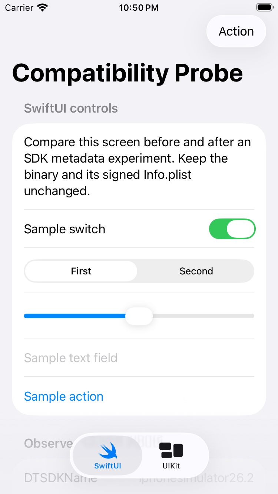
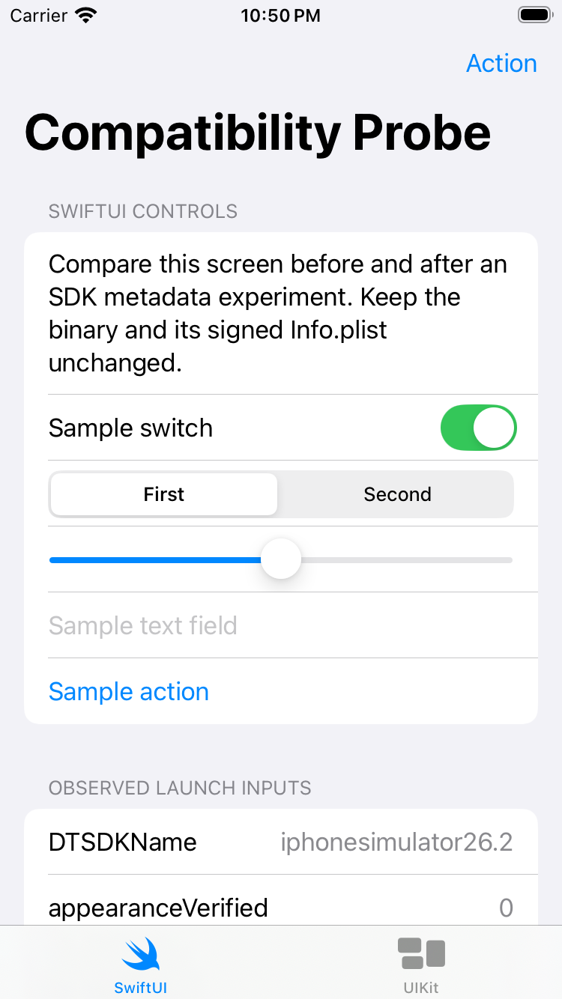

# Validation evidence

## 0.1.4 validation

Version **0.1.4, build 6**, source
[`a91aa393`](https://github.com/Justintunsday/ForceLegacyUI/commit/a91aa39361bea6b2f235e99a6e281442b60806d3),
passed [run 43963044213](https://github.com/Justintunsday/ForceLegacyUI/actions/runs/43963044213)
on the macOS 26 arm64 runner with Xcode 26.2 selected explicitly.

* 28 core XCTest cases and 40 native regression cases passed. The native checks
  exercise production symbol lookup, MHA transport/lifetime and metadata enumeration,
  unreadable positive-token release and alternate-flag retries, recent-inode anchors
  beyond forty million, timeout/resume, checkpoint rejection, diagnostic-source
  handling and ambiguous-store refusal. Private API, path and clock responses are
  injected; this does not verify sandbox access or scanning speed on a phone.
* Standard device apps, the separate enterprise-identity main app and normal
  simulator apps built. The iOS 26.5 iPhone Air simulator launched all three normal
  apps, exported both probes' facts, returned 155 native LS records, and completed
  the synthetic preview/apply/backup/restore cycle with the original SHA restored.
  The MHA variant was device-built only; no phone execution is claimed.
* All four downloaded IPA payloads passed independent ZIP, SHA-256 sidecar,
  version/build, arm64 Mach-O and XML entitlement checks. The MHA artifact has
  display name `ForceLegacyUI MHA`, exact ID `com.apple.mobile.MobileHouseArrest`,
  mode `house-arrest` and no App Group request. The regular app requests its
  dedicated group. No Apple certificate/profile was supplied; the provisioned
  signing job was skipped and every IPA still requires re-signing.

Main IPA SHA-256: `21a77256f5f0496d095e1be84da41bf423cc4d89cee992b2ea5d0b21a804f176`.
MHA IPA SHA-256: `99fe5a42942f1b81ecd72e36eb1327a6cfc66717a7e5f7713b07e651e11fdec3`.
Artifact ID `14275649201`; GitHub-reported artifact ZIP digest
`941a2be4b40b9f94bc756c4d517fa17335a2d27829c08fc634ffaec59fee8873`.
Evidence: [0.1.4 records](evidence/v0.1.4/).

The release includes the independent recent-inode-first and post-grant retry
changes after [ForceDuoApp 1.2](https://github.com/34306/ForceDuoApp/releases/tag/1.2)
review. Earlier unpublished 0.1.4 build 5 artifacts are not this release. The user's
0.1.3 MHA report established returned lsd paths and a prefixed filename, while
mistyped operation-part/part-domain symbols and a shared capability gate prevented
some activation paths. Build 6 fixes those code defects. It does not establish
physical lsd access, the prefixed cache's role, complete app visibility, a reviewed
iOS 26.6.2 layout or a legacy appearance change. The live-write allowlist is empty.

## 0.1.3 validation

Source [`ef889664`](https://github.com/Justintunsday/ForceLegacyUI/commit/ef8896641ef2ecb28f3115de0270f8f2aaf70766)
passed [run 43861332081](https://github.com/Justintunsday/ForceLegacyUI/actions/runs/43861332081).

* 28 core XCTest cases and 17 native policy cases passed. New coverage includes
  lexical alias stability, deriving a cache candidate from another container path,
  resuming valid inode checkpoints, rejecting stale/malformed checkpoints,
  preserving the exact MHA identity contract and refusing unrelated traversal targets.
* Standard device apps, the separate enterprise-identity main app and normal
  simulator apps built. Metadata preparation and packaging checked each variant's
  expected identity/mode and requested entitlements.
* The standard simulator app launched, exported 148 native LS records, and completed
  its synthetic preview/apply/backup/restore test. Both control probes launched and
  exported facts. The MHA variant was device-built, not simulator/device-exploit tested.
* Four downloaded IPA payloads were independently checked: ZIP integrity, SHA-256,
  version 0.1.3, arm64 executable, bundle ID, access mode and XML entitlement request.
  The MHA artifact has ID `com.apple.mobile.MobileHouseArrest`, mode `house-arrest`,
  no App Group request, and requires enterprise-provisioned re-signing. No Apple
  certificate/profile was supplied to this build.

Main IPA SHA-256: `0a684c212fcabc14b9898af82216a42d96cb4548aae48e3fc0f23f66b0ceae48`.
MHA IPA SHA-256: `922331a5cbb09ef7ee997c04cc0d9fa30e42e0603a3cb15c1f456827b91b9d05`.
Artifact ID `14224101265`; ZIP digest
`4689d6575430745a4000ff6c7ba496c8f1cefcc9a11662885451d9af7f48a33c`.
Evidence: [0.1.3 records](evidence/v0.1.3/).

The user's enterprise-signed 3105 result on iOS 26.6.2 is recorded as user-reported
app-data access, not as our verification of the new binary, lsd access, a live-write
layout or appearance. Installation shares/replaces 3105's identity; the
[MHA instructions](ENTERPRISE-MHA.zh-Hant.md) explain that before download/use.

## 0.1.2 validation

Application source commit [`a1a6602f`](https://github.com/Justintunsday/ForceLegacyUI/commit/a1a6602f1a803e0775156d691c8bd416f345decb)
passed [GitHub Actions run 43855369259](https://github.com/Justintunsday/ForceLegacyUI/actions/runs/43855369259).

* All 28 Swift core safety tests and 12 new native discovery/architecture regression
  cases passed. The latter exercise the production coordinator with injected empty
  metadata, denied/empty listings, fixed locations, mapped identities, ambiguous
  stores, unrelated paths and search limits. They do not grant device sandbox access.
* Device and simulator builds passed, along with requested-entitlement preparation,
  native simulator app enumeration, probe exports and synthetic transaction recovery.
  The iOS 26.2 simulator returned 148 native app records; its architecture was arm64.
* Downloaded IPAs were independently checked for ZIP integrity, version 0.1.2,
  arm64 Mach-O executables, SHA-256 sidecars and actual XML entitlement requests.
  The main app requests `group.org.forcelegacyui.app`. Apple-provisioned re-signing
  remains required.
* Main IPA SHA-256: `40fdbddf2add31e838c41d1a6e802e7961a6c6cfc758f4b7054d2fd0fd7aaca9`.

Artifact ID: `14220882951`; artifact ZIP digest:
`857f437206a8c13ce1ed4e70a439469ea65e886a23ff75d64fab07abbaedf3e3`.
Evidence: [0.1.2 records](evidence/v0.1.2/).

The device feedback motivating this change reported iOS 26.6.2 (23G90), no records
from any LS enumeration method, an accessible renamed App Group, and no mapped
store paths. This established that group resolution had succeeded; it did not
establish that worse_query or cache access worked. It also exposed the incorrect
model-as-architecture field. No successful cache read or appearance override on
that device is claimed. The fallback tests cannot substitute for that result.

The subsequent simulator-runner change adds command timeouts and step logging;
it changes no application, core, probe or packaging source in these artifacts.

## 0.1.1 validation

Source commit [`9ccb514a`](https://github.com/Justintunsday/ForceLegacyUI/commit/9ccb514ada262fad09052af880d7d9a8a2a38528)
passed [GitHub Actions run 43775929275](https://github.com/Justintunsday/ForceLegacyUI/actions/runs/43775929275).

* All 28 XCTest safety cases passed, including recognized group rewrites, refusal
  to use unrelated/ambiguous groups, runtime-access requirements and bounded
  read-only cache discovery that leaves unknown SDK fields unavailable.
* Device and simulator apps built. The IPA preparation step ad-hoc signed our
  own build output, verified the seal, and decoded its actual Mach-O XML
  entitlements before packaging. The ZIP payload was independently decoded again
  after download; the main app contains `com.apple.security.application-groups =
  [group.org.forcelegacyui.app]` and version `0.1.1`.
* Native LaunchServices enumeration in the iOS 26.2 simulator returned **148 raw
  records and 148 visible app entries**, including the installed test app. This
  test did not use the demo fixture. A screenshot and full simulator report were
  captured. Simulator enumeration does not prove physical-device visibility.
* The synthetic preview/apply/backup/restore flow and probe fact exports passed.
* No Apple signing certificate/profile was supplied. All released IPA files still
  require Apple-provisioned re-signing; the ad-hoc entitlement request does not
  itself grant App Group access on a phone.

Evidence: [0.1.1 records](evidence/v0.1.1/),
[native simulator screenshot](screenshots/NativeCatalog-0.1.1.png).
Artifact ID: `14186028671`; ZIP digest:
`cd6541b9fd254582e5f4d17cd1ab8d52619fa46610e88cd77ef0fa6f4e1fbc99`.
The subsequent documentation commit adds these records and the Chinese guide
without changing app, packaging or test source.

There is still no verified iOS 26.6.2 live-write profile or physical-device
appearance result. Requested entitlements, actual profile authorization, App
Group container access, worse_query access, record-layout validation and UI
appearance are distinct checks.

## 0.1.0 packaging correction

Device feedback showed an empty visible-app list and an unusable configured App
Group. Inspecting the original 0.1.0 IPA confirmed that its executable had no
`LC_CODE_SIGNATURE`, so re-signing tools could not read the requested App Group
from its signature. The earlier IPA verification covered ZIP structure, executable
presence and hashes; it did not validate the required entitlement metadata.

Version 0.1.1 adds ad-hoc request metadata, verifies the actual binary before
packaging, resolves safe group-name rewrites, and exercises native LS enumeration
in addition to the demo. Its build evidence is recorded above.
The historical 0.1.0 artifacts below are retained as a test record, not the current
recommended sideloading input.

## Historical 0.1.0 validation

The final source build and simulator run passed at commit
[`596e0552`](https://github.com/Justintunsday/ForceLegacyUI/commit/596e055291dcfc85cec478cd814d554bff614c4e).
Its [GitHub Actions run](https://github.com/Justintunsday/ForceLegacyUI/actions/runs/43770790014)
contains device/simulator logs, unsigned IPAs, screenshots and machine-readable
probe/self-test evidence. The subsequent documentation commit adds these results
and screenshots without changing application or build source.

The artifact is `ForceLegacyUI-596e055291dcfc85cec478cd814d554bff614c4e`, ID
`14184462461`, with ZIP digest
`e303b397b82cc175623f053834f9a82ba4a53e1f70f736b76608b4ead2147ffc`.
Selected evidence and IPA checksum sidecars are retained in [evidence/](evidence/).

| Check | Observed result |
| --- | --- |
| Local Python tooling | Project generator consistency and Python syntax checks passed in WSL |
| Core safety tests | 17 XCTest cases executed and passed on macOS, including interrupted-checksum recovery and refusal to overwrite unrelated changes |
| Xcode device build | Main app plus Modern and Legacy probes built with Xcode 26.2 / iPhoneOS 26.2 SDK |
| IPA packaging | Three explicitly unsigned IPA files and SHA-256 sidecars produced |
| Simulator build | All three apps built for the iOS simulator |
| Simulator environment | iOS 26.2, iPhone SE (3rd generation) simulator, arm64 runner |
| Launch smoke check | Each app launched, remained listed as a process, and yielded a screenshot |
| Main app integration | Synthetic dry run preserved the source; apply changed it; backup and restore returned exactly to baseline |
| Probe input controls | Both exported Mach-O and dyld SDK 26.2.0 and LS SDK 26.2; their own plist values were respectively false and true |
| Visual inspection | Screenshots showed the marked demo UI and visibly distinct modern/legacy SwiftUI control styling in the two probes; UIKit-tab screenshots were not captured by this smoke run |
| Offline analyzer | Read the exported synthetic store and reproduced its size, table counts and SHA-256 |
| Downloaded IPA checks | All three payloads, Info.plist executable references, Mach-O headers and SHA-256 sidecars verified locally |
| Provisioned signing | Not run: no signing certificate or profile was supplied |
| Physical iOS 26.6.2 | Not run |
| worse_query grant on a non-jailbroken device | Not verified |
| Real iOS 26.6.2 record layout | Not established; no live-write digest is allowed |
| Legacy appearance for another installed app | Not verified |

The main synthetic test recorded:

```text
before/restored SHA-256: 036b8a8fea6b258779071264cbde428629d4a588fd6800365fec8bbf7ea10e36
applied SHA-256:         55103ac3135bc35c4d8bd777c86d5d38f2e925b7cc230f170abaec4fbb2146cc
```

These are synthetic fixture hashes, not samples from an iOS device database.
The probe export's `kern.osversion` is the simulator host's kernel build,
not an iOS device build. It is explicitly labeled `simulator-host-kernel:...`
and an environment discriminator is exported.

The earlier [15-test build](https://github.com/Justintunsday/ForceLegacyUI/actions/runs/43769668198)
also passed. The final run includes both new recovery tests and the Python
analyzer check. Remaining Xcode warnings concern optional AppIntents metadata
extraction for apps with no AppIntents dependency; no source compilation warning
remains in the final build log.

No simulator evidence is promoted to a physical-device compatibility claim.

## Captured simulator screens




